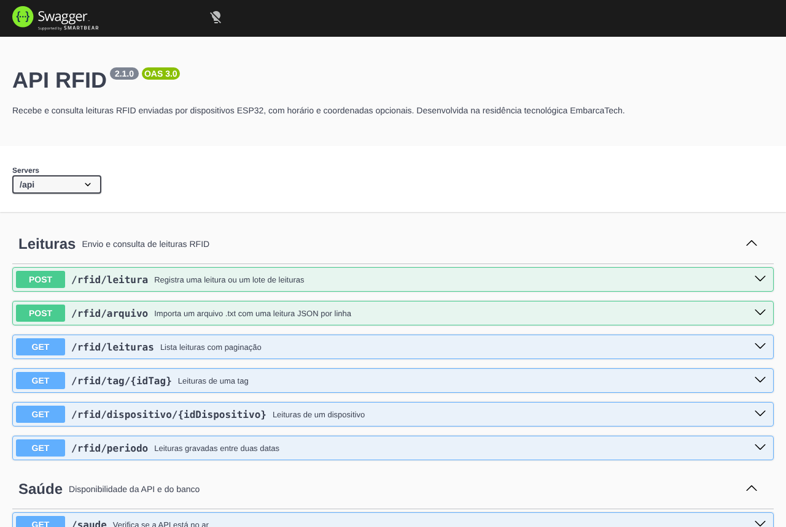

# API RFID · Node.js, Express e PostgreSQL

[](https://github.com/ThalysRD/rfid-server/actions/workflows/testes.yml)

API que recebe e consulta leituras RFID enviadas por dispositivos ESP32, com horário e coordenadas opcionais. Faz parte de um sistema de monitoramento de equipes em obras remotas, desenvolvido em equipe na residência tecnológica EmbarcaTech (Softex/IFRN, 2025–2026) e publicado como artigo na [Revista FT](https://www.revistaft.com/ft/article/view/657). Os dados aparecem num [dashboard Next.js](https://github.com/ThalysRD/Dashboard-RFID).



## O problema

As equipes registram presença com crachás RFID em locais onde a internet cai com frequência. O dispositivo guarda as leituras localmente e envia tudo quando a conexão volta. A API precisa aceitar esses lotes sem perder registros e sem gravar metade de um envio.

## O que a API faz

- **Recebe uma leitura ou um lote** em `POST /api/rfid/leitura`. Um lote vira um único `INSERT` com parâmetros numerados. Se qualquer leitura for inválida, nada é gravado e a resposta aponta o erro pelo índice.
- **Importa um arquivo `.txt`** com uma leitura JSON por linha em `POST /api/rfid/arquivo`. É o caminho dos registros acumulados offline. As inserções rodam numa transação (`BEGIN` / `COMMIT` / `ROLLBACK`), e linhas corrompidas são ignoradas e listadas na resposta.
- **Consulta com paginação** (`?pagina=` e `?limite=`, máximo 200), por tag, por dispositivo ou por período.
- **Valida a entrada:** campos obrigatórios, latitude entre -90 e 90, longitude entre -180 e 180, datas ISO 8601 em ordem.
- **Monitora a si mesma:** saúde da API, conexão com o banco e uso do pool de conexões.
- **Documentação interativa** com Swagger em `/api/docs` (especificação OpenAPI em `/api/docs/openapi.json`).

## Rotas

| Método | Rota | Descrição |
|---|---|---|
| POST | `/api/rfid/leitura` | Uma leitura (objeto) ou um lote (array) |
| POST | `/api/rfid/arquivo` | Arquivo `.txt` (multipart, campo `arquivo`) |
| GET | `/api/rfid/leituras?pagina=1&limite=50` | Lista paginada, da mais recente para a mais antiga |
| GET | `/api/rfid/tag/:idTag` | Leituras de uma tag |
| GET | `/api/rfid/dispositivo/:idDispositivo` | Leituras de um dispositivo |
| GET | `/api/rfid/periodo?dataInicio=...&dataFim=...` | Leituras entre duas datas |
| GET | `/api/saude`, `/api/saude/bd`, `/api/status` | Saúde da API e do banco |
| GET | `/api/docs` | Documentação Swagger |

Exemplo de lote:

```sh
curl -X POST http://localhost:3000/api/rfid/leitura \
  -H "Content-Type: application/json" \
  -d '[{"idTag":"A1B2C3D4","idDispositivo":"esp32-01","latitude":-5.83,"longitude":-35.20},
       {"idTag":"E5F6A7B8","idDispositivo":"esp32-01"}]'
```

## Testes

```sh
npm test                 # 32 testes, sem precisar de banco
npm run test:cobertura   # com relatório de cobertura
```

Os testes usam Jest e Supertest e simulam o banco com um mock, então rodam em qualquer máquina e no GitHub Actions a cada push. Eles cobrem validação, inserção em lote, paginação, filtros, importação de arquivo com `COMMIT` e `ROLLBACK`, JSON malformado e arquivos com tipo errado.

## Rodar localmente

Requisitos: Node.js 18+ e PostgreSQL.

```sh
npm ci
cp .env.example .env          # preencha PGHOST, PGDATABASE, PGUSER, PGPASSWORD
psql "$DATABASE_URL" -f database/schema.sql
npm run dev
```

Para um PostgreSQL local sem SSL, use `PGSSLMODE=disable` no `.env`. Por padrão a conexão usa SSL, como no Neon e no Supabase. A porta vem de `PGPORT` (padrão 5432).

Depois abra `http://localhost:3000/api/docs`.

## Estrutura

```
app.js                  configuração do Express (rotas, CORS, erros)
server.js               inicia o servidor e encerra o pool com segurança
rotas/                  rotas da API e da documentação
controladores/          leituras, importação de arquivo e saúde
infra/bancoDados.js     pool de conexões PostgreSQL
database/schema.sql     tabela leituras_rfid e índices
docs/openapi.json       especificação OpenAPI 3
test/                   testes com Jest e Supertest
```

## Minha contribuição

O sistema completo (firmware, API, banco e dashboard) foi construído em equipe. Neste repositório desenvolvi a API: rotas, validação, inserção em lote, importação de arquivo com transação, consultas e conexão com o PostgreSQL. Também trabalhei no firmware do ESP32, com armazenamento local e sincronização.

## Limites conhecidos

- As rotas não têm autenticação. Antes de usar com dados reais, é preciso restringir o acesso (por exemplo, chave de API por dispositivo) e revisar a validação do certificado SSL do banco.
- Não há medições formais de desempenho ou capacidade, então este README não afirma números.

O README anterior, com exemplos históricos, está em [docs/README_ANTERIOR.md](docs/README_ANTERIOR.md).
